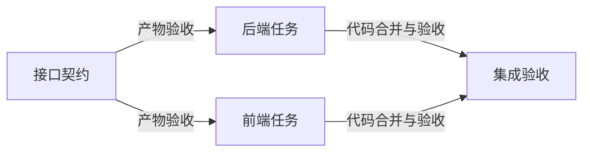

# Superagent

**面向 Codex 的本地多任务协调插件：管理任务依赖、调度 Worker、隔离代码改动，并让人通过控制台审批和干预。**

Superagent 的核心不是让一个 Agent 连续处理单个请求，而是把一个需求组织为有关联的任务图：哪些任务可以并行、哪些必须等待结果、谁占用什么资源，以及什么时候需要人确认。

> 当前为开发预览，不是生产级无人值守系统。环境检查、人工启用和任务/计划审批通过后可以派发 Worker，但完整真实模型、隔离、生命周期和多任务验收仍未完成；也没有可强制执行的总 token/费用上限。请先使用测试仓库，阅读[实施与验收状态](docs/codex-implementation-status.md)。

本项目由原始 `dsh-superagent` 研究原型改造而来，保留原作者署名和 MIT 许可证，不是 OpenAI 或 DeepSeek 的官方产品。Codex 运行时独立于 DSH；原型说明见[历史 README](docs/legacy-dsh-readme.md)。

## 功能概览

| 分类 | 能力 |
| --- | --- |
| 多任务计划 | 建立有向无环任务图，指定依赖、优先级、资源、集成任务、尝试次数和授权到期时间。 |
| 调度与交接 | 满足依赖、授权、Worker 环境和资源条件后派发；区分人工验收的产物依赖与已经合并的代码依赖。 |
| 工作区隔离 | 不同任务使用独立 Git worktree 和任务分支，不让多个 Worker 直接修改同一份工作区。 |
| Worker 内协作 | 一个 Worker 可以运行主 Agent 和受控原生子 Agent，记录分工、进度、结论，并统一停止清理。 |
| 任务通信 | 通过共享上下文线程、订阅和显式路由分发关联信息；追加任务说明持久排队，由下一轮执行消费。 |
| 人工控制台 | 精简任务列表、依赖图、审批中心、阶段结论、阻塞诊断，以及任务中途追加说明和调整范围。 |
| 多项目管理 | 用户级安装、会话级项目绑定、项目级独立服务；不同项目的状态、审批、工作区和控制台分开。 |
| GitLab 交付 | 预览并人工批准发布，提交、推送和创建绑定任务的 Merge Request；不自动合并。 |
| 持久化与恢复 | SQLite 保存任务、输入、审批和执行历史；幂等请求、停止保留、异常隔离与人工对账。 |

**GitHub 是本项目的源码托管平台，GitLab 是当前运行时的远程交付平台，两者不是同一件事。** 受管仓库目前必须没有 `origin`，或使用已登记的 GitLab 实例；暂不支持登记带 GitHub `origin` 的仓库，也不支持 GitHub PR 交付。

## Task、Worker 和 Agent

```text
一个项目的协调服务
└── Plan：关联任务图
    ├── Task A → Worker A → 主 Agent + 受控子 Agent
    ├── Task B → Worker B → 主 Agent + 受控子 Agent
    └── 集成任务：等待前置任务满足交接条件
```

- **Task / Ticket**：持久化的工作单元，包含范围、输入、审批、结果和执行历史。
- **Worker**：任务某轮执行的受控运行环境，使用独立 Codex App Server、项目专用 Worker profile 和任务 worktree；不是 Codex 内置的调度限制名称。
- **Agent**：Worker 内真正执行推理和工具调用的主 Agent 或原生子 Agent。

新 profile 默认允许最多 **3 个并发子 Agent、1 层深度**；旧 profile 不自动启用。Worker 内所有 Agent 共用任务 worktree，不自动获得独立分支，主 Agent 必须拆分不重叠的写文件范围。需要强工作区隔离时，应拆成多个任务。

项目 Worker 并发默认是 **1**，可在私有服务配置中设为 **1–4**；人工跟进唤醒另有一个保留槽位。多个子 Agent 会增加模型用量，不等于增加免费 Worker 槽位。详见[Worker 多 Agent 设计](docs/017-worker-subagents.md)。

## 环境要求

- Node.js **>= 24.2.0**、npm、Git。
- Worker 适配器当前固定支持 **`codex-cli 0.154.0-alpha.6.2`**，不是任意最新版；先用 `codex --version` 核对。
- 当前实现面向 macOS / POSIX，使用 Unix socket、进程组和本地回环控制台；不承诺 Windows 原生兼容。
- 需要用户显式选择的模型/provider，并为 Worker 单独配置认证。不会自动复制主 Codex 会话的账号、插件或 MCP 配置。

只使用独立 Codex 运行时不需要安装原 DSH 依赖。

## 快速开始

### 1. 获取和构建

```sh
git clone https://github.com/pilot1616/superagent.git
cd superagent
npm --prefix packages ci --ignore-scripts
npm run build:codex
node packages/dist/service/src/cli.js help
```

可选检查：

```sh
npm run check:codex
npm --prefix packages run probe
```

`check:codex` 构建并运行独立运行时的测试，其中包含固定 Codex 版本与本地 fixture 的集成检查。fixture 通过不代表真实账号、生产隔离和 GitLab 发布已验收；本机进程检查失败也会使相关测试失败，不应绕过这些检查。

### 2. 安装为用户级 Codex 插件

从项目根目录为插件创建一个**仓库外的新目录**：

```sh
mkdir -p "$HOME/plugins"
npm --prefix packages run configure-plugin -- \
  --destination "$HOME/plugins/superagent" \
  --projects-root "$HOME/.local/state/superagent"
```

如果目标目录已经存在，请选择新目录；该命令不会覆盖现有安装。它为这台主机生成带 Node 和 CLI 绝对路径的 `.mcp.json`，不把本机路径写回通用源码。

**生成副本不等于完成 Codex 安装。** 接着让 Codex 在你授权后完成本地 marketplace 注册和安装，例如：

```text
请把我刚生成的用户目录下 plugins/superagent 插件副本注册到 personal marketplace，
保留现有其他插件，再执行 codex plugin add superagent@personal 并核对安装结果。
使用会话项目模式，不绑定固定仓库，不复制账号凭据，也不要启动 Worker。
```

上面的安装指令以本地 `personal` marketplace 已正确指向该副本为前提。安装后可核对：

```sh
codex plugin list
```

确认 `superagent@personal` 显示已安装、已启用，然后**新建 Codex 会话**加载技能和 MCP 工具。插件包含协调技能与 MCP 入口，不是只有一份提示词的 skill。

目前这是源码依赖型本地安装：插件副本仍依赖本次构建的 `packages/dist` 和 `packages/node_modules`。不要删除或移动源码目录，也不要把这台机器生成的插件副本直接发给别的主机；另一台主机需要重新构建和配置路径。完整说明见[插件安装与本地分发](docs/codex-usage.md#4-mcp--插件副本)。

### 3. 在任意会话选择要管理的项目

在目标项目的 Codex 会话中说明：

```text
使用 Superagent 管理当前会话的 Git 项目。
首次初始化前向我确认项目路径和模型；不要使用安装插件的源码仓库作为默认项目。
初始化后给我这个项目的控制台地址和登录令牌文件路径。
```

插件通过 `superagent_project_open` 绑定当前项目。首次初始化需要明确同意与模型选择；如果未配置本机默认模型，必须显式传入模型。已有项目复用自己的服务，不把不同项目装进同一个任务库。

初始化/打开项目只启动协调服务和控制台，不等于允许 Worker 运行。返回的 `dashboardUrl` 和 `loginTokenFile` 属于**这个项目**；在可信终端自行读取令牌并登录，不要把令牌交给模型、粘贴到 issue 或提交到 Git。

### 4. 准备并人工启用 Worker

1. 根据本项目的 Worker profile，显式配置模型/provider 和所需认证；不要拷贝主会话的整个配置目录。
2. 打开项目控制台，运行 Worker 诊断，处理版本、认证、权限或进程检查问题。
3. 查看启用预览，确认权限和费用限制，再由人启用该项目的运行环境。
4. 另行审批任务或计划，调度器才会派发符合条件的 Worker。

完整验收报告不再是启动硬门槛，但**环境检查、人工启用和任务授权仍必须满足**。缺少条件时任务保留为等待状态；不要通过删除检查或伪造验收记录来解锁。详见[运行环境准入规则](docs/016-worker-verification-advisory.md)。

## 如何分发关联任务

例如，在已经绑定项目的会话中提出：

```text
把“新增成员管理页面”组织成 Superagent 多任务计划：
1. 先定义接口契约，人工验收后交给前后端。
2. 后端与前端并行开发，分别使用不同任务分支和资源键。
3. 最后安排集成任务，等待前后端代码已合并且结果被验收。
请先展示依赖图、范围、尝试次数和授权有效期，再申请我的计划审批。
```



基本流程：

1. **拟定计划**：建立任务图和共享上下文；创建计划本身不执行。
2. **人工授权**：在控制台审批计划的范围、依赖、资源、预算和有效期；这里的预算主要是尝试次数，不是硬 token 费用额度。
3. **调度执行**：检查前置结果、资源锁、Worker 槽位和环境条件，创建 worktree 后派发。
4. **中途监督**：查看分工、阶段结论与阻塞；追加说明由下一轮消费，不是实时打断当前推理。
5. **必要时调整**：暂停并修改范围会撤回旧授权；计划成员调整会停止整组，需要重新审批，历史结论保留。
6. **结果交接**：人的验收才会形成依赖结果；子 Agent 的摘要不等于任务完成。代码依赖还要求合并代码进入下游基线。
7. **交付与收尾**：如需 GitLab MR，先预览并审批发布；MR 合并由人或外部流程处理，最终人工验收集成结果。

跨任务代码不会因为消息互通就自动合并。已验收产物不可原地覆盖；修改需求应建立新任务或计划。执行后的依赖图也不能随意改写。

## 不安装插件也可以启动

使用 CLI 初始化一个测试实例，所有路径和模型名都需要替换为你自己的值：

```sh
node packages/dist/service/src/cli.js init \
  --repo /absolute/path/to/test-repository \
  --worktrees /absolute/path/to/separate-worktrees \
  --state /absolute/path/to/private-state \
  --base main \
  --model YOUR_EXPLICIT_MODEL

node packages/dist/service/src/cli.js serve \
  --state /absolute/path/to/private-state
```

在另一个终端启动控制台：

```sh
node packages/dist/service/src/cli.js panel \
  --state /absolute/path/to/private-state \
  --port 0
```

`--port 0` 使用可用端口，以命令实际返回的地址和令牌文件为准。state、受管仓库和 worktree 根目录不能互相嵌套；state 必须位于插件缓存与源码之外。完整 CLI、任务/计划 JSON、认证与恢复步骤见[使用说明](docs/codex-usage.md)。

## 控制台和安全边界

- 默认关注计划与依赖，任务页分页展示；点击图节点可看阶段结论、历史轮次和阻塞原因。
- 控制台使用本地回环地址、私有登录令牌和同源/CSRF 检查，不应直接暴露到公网。
- 公共 MCP 能创建和申请任务，但没有人工审批、运行环境启用或任意管理 shell 的权限。
- 人工停止会保留停止状态，普通消息和重启不能自动解除；清理无法确认时保留隔离并要求人工对账。
- 任务上下文和代码可能发送给所选模型/provider；使用前确认数据和账号权限，多 Agent 会增加用量。
- 私有 state、数据库、令牌、Worker 认证和真实执行证据不能打包或提交。GitLab 发布默认关闭，不自动登录、推送或合并。

### 更新已有安装

拉取源码后重新安装依赖并构建，通过插件安装流程同步本地副本、刷新缓存版本并重新安装，最后新建会话。不要直接覆盖已经存在的 `configure-plugin` 目标目录，也不要把通用 `.mcp.json` 覆盖到已经生成的本机配置上。

运行中的项目服务不会因为插件重装而热更新；先确认没有活动或不确定执行，再显式停止/重启该项目服务。旧 profile 的多 Agent 开关需要停服后显式配置，并重新诊断和人工启用，不会自动迁移授权。不要为了更新一个项目而停止其他项目的任务。

## 项目结构

| 路径 | 内容 |
| --- | --- |
| `plugins/superagent/` | 通用插件清单、协调技能和 MCP 配置模板。 |
| `packages/core/` | 任务、上下文、计划、调度与依赖领域逻辑。 |
| `packages/executor-codex/` | 固定版本 App Server 协议、Worker、子 Agent 和进程生命周期。 |
| `packages/service/` | CLI、本地服务、项目绑定、运行环境管理和控制台接口。 |
| `packages/storage/` | SQLite 持久化。 |
| `packages/mcp/` | 对 Codex 暴露的协调工具。 |
| `packages/integrations-gitlab/` | GitLab API、MR 交付与工作区操作。 |
| `apps/panel/` | React 人工审批和任务控制台。 |
| `packages/tests/` | 独立 Codex 运行时测试与本地 fixture。 |
| `docs/` | 设计、使用说明、迁移与验收状态。 |
| `src/`、`prompts/`、`skills/` | 保留的原始 DSH 研究原型，不是新的 Codex 运行时入口。 |

独立 Codex 检查使用 `npm run check:codex`；原始 DSH 原型仍使用根目录的 `pnpm check`，两者不能互相替代。

## 设计与使用文档

- [使用说明](docs/codex-usage.md)：构建、初始化、插件、CLI、控制台、GitLab 与恢复。
- [实施与验收状态](docs/codex-implementation-status.md)：区分已实现功能、fixture 测试与真实环境证据。
- [009 · Codex 插件改造设计](docs/009-codex-plugin-design.md)。
- [010 · 关联多任务编排](docs/010-multi-task-orchestration.md)。
- [011 · 本地审批控制台](docs/011-local-control-panel.md)。
- [012 · 会话项目绑定](docs/012-session-project-binding.md)。
- [013 · 任务驾驶舱](docs/013-task-cockpit.md)。
- [014 · Worker 运行环境解锁设计](docs/014-worker-runtime-unlock.md)与[015 · 实施记录](docs/015-worker-runtime-implementation.md)。
- [016 · 验收门槛调整](docs/016-worker-verification-advisory.md)：当前准入规则以此修订为准。
- [017 · Worker 内多 Agent](docs/017-worker-subagents.md)。

## 来源与许可证

本项目保留原始 DeepSeek Harness Team `dsh-superagent` 研究原型及其版权声明。原型的 DSH/GitHub/飞书集成与新的 Codex/GitLab 运行时是不同实现，不能混用初始化状态或历史授权。

- 原型介绍与文档入口：[历史 README](docs/legacy-dsh-readme.md)。
- 原型安装流程：[SETUP.md](SETUP.md)，仅适用于 DSH 原型。
- 许可证：[MIT](LICENSE)。
