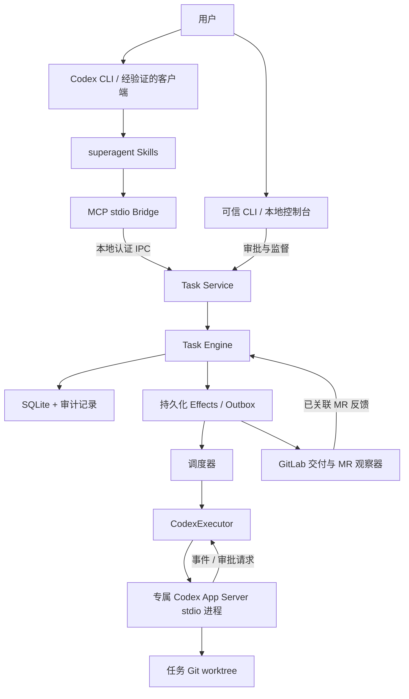

# 009 Codex 插件改造设计

> 状态：设计基线；后续已开始实施，但尚未完成 v1 验收。日期：2026-11-16。
> 目标：从 dsh-superagent 提取工单、编码执行、MR 协作、人工监督和可靠运行能力，以 Codex 插件作为关联多任务编排与调度的操作入口，最终不依赖 DSH 运行。单任务执行是调度系统的执行单元，不是产品的主要使用形态。
> 本文保留原设计阶段的提案及核实记录，不将设计目标改写为已完成事实。当前实现与验收状态见 `docs/codex-implementation-status.md`，实际命令见 `docs/codex-usage.md`。
> 2026-11-17 交付平台修订：新 Codex 运行时改用 GitLab Merge Requests；旧 DSH 原型的 GitHub 源码与历史引用保持不变。旧 GitHub 状态、token、审批和 PR 绑定不自动迁移。
> 2026-11-17 产品定位修订：核心是任务集合、任务关系和调度处理，不是多个独立任务的并发运行。恢复清单、实现契约与验收映射见 [010 关联多任务编排与调度设计](010-multi-task-orchestration.md)；本地实现证据见实施记录，单任务闭环或有限并发测试不能代替编排验收，编排验收也不代替真实 Worker 安全验收。

## 1. 结论与实施边界

可行，但不能仅把 DSH 插件清单改名为 Codex 插件清单。改造的主体是一个独立的本地任务服务，Codex 插件为它提供 Skills 与 MCP 工具入口，Codex App Server 替代 DSH 的执行会话。

推荐形态：**Codex 插件 + 本地任务服务 + Codex 执行适配器 + GitLab 交付适配器**。

原设计阶段仅交付设计文档和本地 Git 跟踪，不安装插件、不启动 Worker、不调用模型执行任务、不配置远程仓库，也不修改原有运行逻辑。后续实施沿用以下边界，以独立验收记录为准。

### 1.1 保留的五类能力

| 原功能编号 | 目标能力 | 第一版范围 |
| --- | --- | --- |
| 3 | 工单与关联上下文管理 | 人工建单、任务集合与依赖关系、任务详情、追加输入、状态和历史、人工停止与显式恢复 |
| 4 | 编码与编排调度 | 依赖就绪判定、优先级、资源约束、Codex Worker、任务工作目录、有限并发、取消与恢复 |
| 5 | MR 交付与反馈 | 受控发布分支与 MR、跟踪已关联 MR 的评论、审查、CI、合并和关闭 |
| 6 | 人工协作与监督 | Codex 对话查询与操作、可信本地审批入口、简化看板 |
| 8 | 持久化与运维 | SQLite、持久化副作用队列、幂等、故障重试、服务生命周期与健康检查 |

完整 v1 包含上述五类，以及 010 增补中的关联多任务验收。原 MVP 的人工建单到本地执行、停止、恢复闭环仅是底层验证，不代表产品主要目标已经完成；任务图和调度器需优先补齐，不能只增加 Worker 数量或看板列表。

### 1.2 不迁移的产品功能

- 飞书接入、群消息监听、历史补拉和飞书账号管理。
- GitLab 全仓库发现新任务、通知接单，以及基于消息内容主动决定是否接单。
- 外部来源的主动发现与无人请求的自动接单不迁移；原有主 Agent 的任务关联、路由判断、上下文分发和多任务协调必须保留，由 Codex 主会话通过受控领域命令操作。移除 DSH 宿主不等于移除协调层。
- 完整的团队提示词编辑器、Skills 商店和复杂版本比较 UI；保留必要的固定 Worker 指令及配置版本。
- DSH 的 Cordis 插件加载、Web 宿主、会话控制与工具注册系统。
- 多租户、远程公网服务、跨仓库依赖调度、自动合并、任意后台子 Agent 树管理。

第一版只支持本地单用户、单个登记的 Git 仓库内的多任务编排。单仓库不等于单任务；数据库可保存 repositoryId，但这不等于已经支持多仓库调度。

### 1.3 不能一并删掉的底层机制

1. 去掉“消息接单”不等于去掉 MR 事件读取；第 5 类仍需要 GitLab 反馈。
2. 去掉“自动准入评估”不等于取消授权；仍需身份、任务范围、执行权限、人工停止和审批审计。
3. 去掉完整提示词配置 UI，不等于 Worker 无需指令、模型配置和工具约束。
4. 插件安装不等于后台服务已启动，更不等于关闭 Codex 后仍持续运行。
5. 会话可恢复不等于任意网络操作可以自动重放，更不等于完整恢复进程、服务器和子 Agent。

### 1.4 多任务是主流程，单任务是执行单元

用户提交一个目标或一组任务，确认任务关系与授权边界；服务维护任务图，持续决定哪些任务可并行、哪些需要等待上游、哪些受资源约束，以及失败和重试影响哪些后续任务。Codex 可以提出拆分和关系建议，但不能自批执行权限。

主流程为：**目标/任务集合 → 任务图与计划确认 → 就绪集合计算 → 有界并行派发 → 结果验收与下游解锁 → 集成验证 → 整体交付**。MR 是交付载体，不是调度中心。

改造审计发现，最初的新运行时只继承了独立任务队列，遗漏了原有 Thread/Subscription/Correlation、主会话路由和差异化唤醒。010 明确先恢复这些核心语义，再增加显式依赖图；不得把原有能力缺失解释为用户新增需求。实现与测试状态见实施记录；原有人工停止、发布审批、单写者和执行安全门禁继续有效。

## 2. 依据、已核实能力与待验证项

### 2.1 当前项目事实

| 事实 | 代码依据 | 改造含义 |
| --- | --- | --- |
| Engine 是领域状态的同步事务入口 | `src/core/engine.ts`、`src/core/part.ts` | 保留单一写入口，新增人工任务命令，而不是在 MCP 层直接写表 |
| 任务创建依赖 Trigger、Decision、Mandate | `src/core/tickets.ts`、`src/core/model.ts` | 需要真实的人工来源与授权模型，不能伪造 LLM 评估结果 |
| DshExecutor 依赖 DSH Context 和 Sessions | `src/executor/dsh.ts`、`src/app/sessions.ts` | 执行与会话适配器需要重写 |
| 后台任务管理依赖 DSH jobs/subagents | `src/executor/background.ts` | 不可承诺原样移植，第一版明确限制后台子任务 |
| MR 观察和来源接口相互耦合 | `src/sources/github-pull.ts`、`src/sources/github.ts` | 提取绑定、状态观察和反馈，移除新需求发现 |
| SQLite + Effects + Outbox 支持持久化工作 | `src/app/store.ts`、`src/app/effects.ts`、`src/app/outbox.ts` | 优先复用事务和重试模式，解除 SourceRegistry、DSH 等依赖 |
| HTTP 与 React 面板挂载在 DSH 宿主 | `src/app/http.ts`、`src/client/index.tsx` | 不能当作独立网站直接启动，需要新的入口与导航适配 |
| 原 Worker 使用 danger-full-access | `src/app/sessions.ts` | 新实现不照搬；最小权限与审批是第一阶段条件 |

阅读基础可参照 [001 领域模型](001-domain.md)、[003 执行机制](003-execution.md) 和 [007 架构](007-architecture.md)。

### 2.2 Codex 能力核实

核实环境：本机 `codex-cli 0.154.0-alpha.6.2`，Node.js `v24.2.0`，Git `2.49.0`。这是本机观察值，不是宣称最新版本或最低兼容版本。

| 能力 | 核实依据 | 采用策略 |
| --- | --- | --- |
| 插件可以组合 Skills 和 MCP 服务 | 官方插件架构 [O1] | 插件作为入口，服务实现持久化业务 |
| `.codex-plugin/plugin.json` 兼容布局仍受支持 | 官方打包文档 [O2]、本地 plugin-creator 指引 | 第一版用兼容布局，减小本机接入风险 |
| 官方也提供根目录 `plugin.json` / `mcp.json` 可移植格式 | [O2] | 后续单独迁移；不能只改文件名或同时维护冲突清单 |
| App Server 支持双向 JSON-RPC、stdio、线程和 turn 操作 | [O3]、本机命令帮助 | 第一版使用专属子进程的 stdio，不开放远程 WebSocket |
| 本机普通协议类型包含 thread/start、resume、read 和 turn/start、steer、interrupt | 本机 `generate-ts` 输出 | 以本机固定版本生成的类型为准，官网较新字段不直接照搬 |
| `turn/start` 有 outputSchema；`turn/steer` 要求 expectedTurnId | [O3] 和本机生成类型 | 结构化报告 + 并发前置条件；仍校验模型输出 |
| App Server 向客户端发审批请求 | [O3] | 服务必须实现可信审批桥，不能默认为同意 |

本次只运行了版本、帮助和协议类型生成命令，没有调用模型；尚未验证实际账号认证、线程执行、审批弹窗、断线恢复或插件安装。

### 2.3 兼容性闸门

实现前必须用真实环境通过以下验证，否则暂停对应功能，不能以更宽权限或猜测字段兜底：

- MCP 配置能在目标 Codex CLI 中加载，桥接可执行文件在插件缓存和不同启动目录下均能找到。
- App Server initialize/initialized 握手、线程创建、turn 事件和取消事件能完成闭环。
- 本机模型与认证可用；不假设所有订阅、模型、推理参数和账户权限均可用。
- Worker 能禁用父会话中的 superagent 插件、控制 MCP 和不必要的个人插件，避免递归派单。
- 工作树和 Git 公共元数据访问权限可精确表达；权限不足时请求授权而非改成全权限。
- 审批请求能可靠关联到线程、turn、item 和当前连接；过期审批不能被重用。
- 恢复时能查询线程与执行事实；如果不能确认输入是否被接收，显示待核对而不是盲目重发。

原生 Codex 侧边栏嵌入、自建 Worker 自动出现在当前用户会话列表、关闭 UI 后主动推送消息，都不是第一版承诺。插件工具必须在没有自定义 UI 时可用。[O1]

## 3. 总体架构



### 3.1 进程边界

| 进程 | 职责 | 生命周期 |
| --- | --- | --- |
| Codex 主会话 | 理解用户命令、调用任务工具、呈现结果 | 用户管理 |
| MCP Bridge | 协议转换、连接认证、短请求、输出裁剪 | Codex 启动或关闭 MCP 时创建或结束 |
| Task Service | 唯一数据库写者、领域命令、队列、审批、调度、MR 观察 | 独立于 Bridge；先手动前台运行，再可选系统服务 |
| Worker App Server | 执行一个任务的当前会话并输出事件 | 服务创建、关联、取消、回收 |
| 本地控制台 | 可信审批、任务列表、运行状态 | 不影响后台任务是否存在 |

第一版选择一个活动 Ticket 对应一个专属 App Server 子进程，避免终止某个任务时影响其他任务。进程可以回收，但持久化 Codex threadId；下次用 thread/resume 继续。使用本地固定版本支持的默认会话持久化，不能使用 ephemeral 会话承诺重启恢复。

暂不连接或控制用户正在使用的 Codex 主会话，也不复用未经验证的全局 App Server daemon。这样取消、配置和生命周期的所有权更清楚。

MCP Bridge 不持有 SQLite 写连接，不为每次调用启动一个新调度器。多个 Codex 窗口连接同一用户的 Task Service，仍只有一个服务实例持有状态锁。

### 3.2 交互契约

- `task_create`、`task_message` 等工具返回持久化结果，不等待编码完成。
- 查询返回任务状态、最近事件、需要人工处理的事项和分页游标；不把全部模型上下文塞回 Codex。
- 无法确认后台任务已启动时，不向用户返回“正在执行”。
- 不承诺后台事件能主动打断一个已关闭或空闲的 Codex 对话；用户查询、有限等待或本地控制台读取新事件。
- 工作流说明可以提示用户下一步，但 Skills 不代替服务端校验、授权和状态机。

## 4. 代码拆分与迁移路径

### 4.1 复用与改写矩阵

| 当前代码 | 处理方式 | 目标位置（拟议） | 注意点 |
| --- | --- | --- | --- |
| `src/core/model.ts`、`stage.ts`、`errors.ts` | 提取并演进 | `packages/core/src/` | 保留任务、分配、报告和阶段语义；扩展人工来源 |
| `src/core/engine.ts`、`tickets.ts`、`assignments.ts` | 复用规则，新增人工命令 | `packages/core/src/` | MCP/HTTP 不得绕过 Engine 修改领域表 |
| `src/core/intake.ts`、`evals.ts` | 缩减/移除新运行时依赖 | `packages/core/src/inputs/` | MR 反馈归已有任务；不再创建主动评估 |
| `src/policy.ts`、`app/assessment.ts` | 替换主动准入，保留授权观念 | `packages/core/src/authorization/` | 不保留“所有人都允许”的恒真 Policy |
| `src/app/store.ts`、`effects.ts`、`versions.ts` | 提取，拆开旧设置依赖 | `packages/storage/src/` | 事务、索引、租约、版本迁移需单测 |
| `src/app/outbox.ts` | 保留可靠投递，改传输端口 | `packages/service/src/outbox/` | 去掉 Feishu 和 SourceRegistry 强耦合 |
| `src/executor/dsh.ts`、`app/sessions.ts` | 重写 | `packages/executor-codex/src/` | 不模拟 DSH Agent API，定义窄执行接口 |
| `src/executor/background.ts` | 不原样迁移 | `packages/executor-codex/src/processes/` | 禁用不受控后台子任务，逐步验证所有权与回收 |
| `src/sources/github-pull.ts`、`github-read.ts`、`github-channel.ts` | 提取必要逻辑 | `packages/integrations-gitlab/src/` | 只观察任务已关联的 MR 与受控发布 |
| `src/sources/feishu*`、`app/assessment.ts` | 新产品不打包 | 原树暂留 | 迁移完成前不删除原实现 |
| `src/app/runtime.ts`、`setup.ts`、`index.ts` | 重写组合入口 | `packages/service/src/` | 不依赖 Cordis 服务注入 |
| `src/app/http.ts`、`app/views/*` | 复用纯查询，替换宿主 | `packages/service/src/http/` | 回环访问、认证、CSRF、防泄露 |
| `src/client/*` | 选择性复用组件 | `apps/panel/src/` | 新 React 入口，不依赖 DSH slots、locale、session 导航 |
| `prompts/*`、`skills/*` | 按角色裁剪 | 插件 Skills + Worker 指令 | 删除 DSH 工具名和自动接单假设 |
| `tests/*` | 按行为迁移 | 各 package 的测试目录 | 尤其保留并发、输入投递、停止和恢复用例 |

### 4.2 渐进迁移策略

1. 保留根目录原项目及其检查流程，先增加 Codex 相关 package，不立即大规模搬目录。
2. 抽取 core/storage 时，每次只迁一个边界；避免让新代码导入整个旧 Runtime。
3. 每个已抽取模块明确唯一实现位置；旧运行时如需使用它，改成兼容导出，避免长期维护两份业务逻辑。
4. 新执行器和 MCP 入口用 mock 及契约测试驱动，不先连接真实仓库执行。
5. 新闭环通过验收后，再移除发布包中的 DSH 依赖；原型代码的最终归档另做提交。
6. 第一版新数据库不自动读取或升级已有 `orchestrator.sqlite`。旧任务导入是独立工作，必须有备份、只读试跑和显式确认。

### 4.3 拟议目录

```text
docs/
  009-codex-plugin-design.md
packages/
  core/                     # 领域模型、状态机、授权与端口
  storage/                  # SQLite、迁移、Effects、审计
  service/                  # 调度、生命周期、IPC、HTTP、可信 CLI
  executor-codex/            # App Server 传输、线程/turn、事件与审批
  integrations-gitlab/      # 发布、MR 观察、评论与 CI
  mcp/                      # 工具 schema、stdio Bridge
apps/
  panel/                    # 简化本地看板，后置实施
plugins/
  superagent/
    .codex-plugin/plugin.json
    .mcp.json
    skills/superagent/SKILL.md
    scripts/
```

`packages/*`、`apps/*` 成立后再添加 workspace/build 配置。根目录旧 `pnpm check` 与新项目检查需明确分开，不能把“未检查新包”当成全项目通过。

## 5. 插件包装与安装设计

### 5.1 插件职责

插件公开的能力是任务创建、查询、追加要求、状态控制和交付申请。它不在安装时静默启动后台模型任务、不自动扩大文件权限、不把 GitLab 凭据打进清单。

Skill 至少写明：

- 哪些用户表达应转成任务，哪些只是咨询；咨询不能自动变成执行。
- 创建、启动、发布和合并是不同授权动作。
- 已有 Ticket 的追加请求必须携带 ticketId，而非重复新建。
- 人工停止后，追加信息不代表允许恢复。
- 工具返回未知、失败或待核对时，应如实呈现，不自行改写状态。
- Worker 不使用控制插件派生新任务，也不审批自己。

### 5.2 拟议兼容清单

第一版采用本机 plugin-creator 所支持、官方仍兼容的布局。[O2]

```json
{
  "name": "superagent",
  "version": "0.1.0",
  "description": "Manage local coding tasks, Codex workers and merge-request delivery.",
  "skills": "./skills/",
  "mcpServers": "./.mcp.json"
}
```

以下为 MCP 配置逻辑示例，`superagent-local` 是未来实现的可执行文件，不是本机现有命令：

```json
{
  "mcpServers": {
    "superagent": {
      "command": "superagent-local",
      "args": ["mcp", "bridge"]
    }
  }
}
```

安装器必须验证该命令的解析结果；对于 GUI 的不同 PATH，选择实际支持的打包方式或生成本地绝对路径配置。不可把开发机器路径提交为通用清单，不假设未验证的插件根目录环境变量适用于 MCP。

不使用 hooks 自动启动服务作为核心机制，也不依赖尚未验证的原生 UI 扩展。插件包保持静态，SQLite、日志和凭据放在独立状态目录，避免插件更新或卸载丢失任务。

### 5.3 安装与更新流程

1. 构建并校验插件清单、Skill、Bridge 可执行文件和运行依赖。
2. 经用户批准安装本地服务及个人 marketplace 条目；不擅自改全局 Codex 配置。
3. 用本机 `codex plugin` 帮助确认安装命令；由安装测试验证插件可发现、可加载。
4. 显式登记一个本地仓库、允许的执行根目录和模型配置。
5. 显式启动服务并执行只读健康检查，再创建测试任务。
6. 更新时暂停派发、备份数据库，完成 schema 检查后切换版本；插件版本和服务 API 版本不匹配时拒绝写操作。
7. 卸载插件只移除入口，停止服务及删除任务数据需要分别确认。

任务服务会向模型供应商发送任务和必要的代码上下文；“本地服务”不代表模型推理完全离线。README 和安装确认中须说明这一点。

## 6. 领域模型与人工建单

### 6.1 新增命令，不伪造自动评估

建议新增 `Engine.createManualTask`、`Engine.appendManualInput`、`Engine.startTask`、`Engine.stopTask`、`Engine.resumeTask` 等角色受限接口。接口名为设计，实施时与现有命名统一。

`createManualTask` 的原子操作：

1. 从认证连接取得操作者身份，不相信模型传来的 actorId。
2. 校验已登记 repositoryId、任务范围、目录配置与幂等键。
3. 写入 `origin.kind = manual` 的请求记录与本地讨论线程。
4. 创建明确由人工指派产生的授权依据；保存范围、允许动作与权限配置版本。
5. 写 Ticket、审计事件和待处理记录。
6. 默认保存为待启动；只有已经取得绑定该任务的执行授权时，才原子创建 Assignment 和 launch effect。

保留来源链与审计，并以 `decision.origin = manual` 或独立 ManualRequest 表达人工决定；不能虚构命中某条主动规则。

后续 GitLab 反馈只追加到已关联任务，不触发“发现新任务”。超出授权范围的反馈形成 Attention，由用户确认范围变更。

### 6.2 主要对象

| 对象 | 重要字段 | 规则 |
| --- | --- | --- |
| Repository | id、canonicalPath、remote、baseRef、允许的执行根目录 | 只能使用已登记对象，模型不能随意传磁盘路径 |
| Ticket | id、title、scope、origin、mandate、ended、revision | 保留稳定任务 ID；revision 支持乐观并发 |
| Mandate | operator、scope、allowedActions、policyVersion、humanHold | 人工停止不可被 CI/机器人或普通追加消息解除 |
| Input | id、ticketId、source、sequence、content、deliveryState | 持久化、顺序投递、记录输入是否被实际执行读取 |
| Assignment | id、ticketId、generation、state、startedAt、endedAt | 重试创建新分配，旧分配不可继续提交有效报告 |
| SessionBinding | ticketId、codexThreadId、activeTurnId、runtimeVersion、profileVersion | 一个任务的持久线程不等同于一次 turn |
| Report | assignmentId、state、summary、checks、artifacts、question | 结构化校验；报告 ready 不代表 MR 已合并 |
| Approval | connectionEpoch、rpcRequestId、threadId、turnId、itemId、status | 绑定当前执行上下文；不得跨 turn 重放 |
| MergeRequestBinding | repositoryId、iid、branch、lastHeadSha、state | MR 归属校验，不能任意控制其他任务 MR |
| Effect | kind、key、generation、payload、dueAt、attempts、lease | 数据库提交之后执行；至少一次投递，靠业务幂等收敛 |

SessionBinding 中保存的是标识、版本与核对点，不直接修改 Codex 内部会话文件。Codex 自身负责其会话格式，服务通过受支持的协议读取或恢复。

### 6.3 状态语义

保留“领域终态 + Assignment 状态 + Report + Attention 推导展示阶段”的模式，不新增一堆互相矛盾的 status 字段。

| 展示阶段 | 进入条件 | 退出条件 |
| --- | --- | --- |
| 待启动 | 已建单、尚未授权执行 | 显式启动或取消 |
| 排队 | 有待执行 Assignment，尚无槽位 | 取得调度槽位 |
| 执行中 | 活动 turn 或受控执行正在运行 | 报告、阻塞、取消、故障 |
| 等待审批 | 有有效的执行权限/变更审批请求 | 用户在可信入口批准或拒绝 |
| 等待回答 | 有 Worker 提出的具体问题 | 人工答复后恢复 |
| 等待评审 | ready 报告且仍有相关开放 MR | 反馈引发新 turn，或 MR 结束 |
| 等待反馈 | 无活动 turn、任务仍开放 | 新输入或显式继续 |
| 阻塞/失败 | 明确报告失败或重试预算耗尽 | 人工重试或新授权动作 |
| 停止中 | 已撤销派发权限、取消尚未确认 | 执行终止被确认；失败则保持待核对 |
| 已停止 | 人工停止已完成 | 只能显式恢复；普通追问不解除停止 |
| 已完成 | 无 MR 的工作已交付，或 MR 关闭/合并条件满足 | 新工作需显式恢复或新建任务 |

调度暂停是服务级开关，不等于停止任务，也不应立即中断所有运行中的 turn。状态页明确展示暂停范围。

## 7. MCP 工具与服务接口

### 7.1 拟议公共工具

| 工具 | 输入重点 | 返回值 | 副作用 |
| --- | --- | --- | --- |
| `superagent_task_create` | repositoryId、title、request、requestId | ticketId、revision、stage | 创建任务，默认不启动 |
| `superagent_task_start` | ticketId、expectedRevision、requestId | stage、assignmentId 或审批要求 | 在已有执行授权下入队 |
| `superagent_task_get` | ticketId、事件游标 | 摘要、阻塞、MR、最近事件 | 只读 |
| `superagent_task_list` | 状态过滤、cursor、limit | 任务页、nextCursor | 只读 |
| `superagent_task_message` | ticketId、text、requestId | inputId、deliveryState | 持久化追加输入，不隐式解除人工停止 |
| `superagent_task_stop` | ticketId、expectedRevision、reason、requestId | stopping/stopped、operationId | 持久化撤销执行并请求取消 |
| `superagent_task_retry` | ticketId、expectedRevision、requestId | assignmentId 或拒绝原因 | 只适用于允许重试的失败任务 |
| `superagent_task_resume` | ticketId、expectedRevision、requestId | stage 或审批要求 | 必须有显式恢复意图与有效授权 |
| `superagent_task_publish` | ticketId、headSha、requestId | 发布预览、审批要求或 MR 结果 | 推送和开 MR 由受控发布服务执行 |
| `superagent_health` | 无敏感输入 | 版本、连接、队列、阻塞摘要 | 只读 |

第一版不暴露任意 shell、任意 SQL、任意文件读写、任意仓库 URL 或 `approve_all` 工具。命令审批通过可信 UI/CLI，不提供一个模型可直接调用并声称“用户已同意”的批准工具。

可增加有超时上限的事件等待工具，但它只改善查询体验，不能通过无限阻塞 MCP 请求实现后台任务存活。

### 7.2 幂等与并发

- 写操作使用 `(operatorId, operation, requestId)` 唯一键，保存 payloadHash 与原始结果。
- 相同键和相同内容返回原结果；相同键但不同内容返回 `IDEMPOTENCY_CONFLICT`。
- 非首次业务操作使用 expectedRevision；不一致返回 `REVISION_CONFLICT` 及当前摘要。
- 外部调用超时先标记 `unknown` 或 `reconciling`，不能直接认为没发生。
- 工具成功仅代表已完成相应持久化/业务阶段；入队成功不能写成编码成功。

### 7.3 统一返回与错误

拟议工具返回 envelope：

```json
{
  "ok": true,
  "data": {
    "ticketId": "task-example",
    "stage": "queued",
    "revision": 3
  },
  "operationId": "op-example"
}
```

示例 ID 仅说明数据形状。错误包括 `UNAUTHENTICATED`、`FORBIDDEN`、`NOT_FOUND`、`INVALID_STATE`、`REVISION_CONFLICT`、`IDEMPOTENCY_CONFLICT`、`APPROVAL_REQUIRED`、`RUNTIME_UNAVAILABLE` 和 `RECONCILIATION_REQUIRED`。

采用 MCP SDK 的结构化结果和错误表达，并将业务错误显式标为失败；不把堆栈、访问令牌、环境变量、完整模型日志作为面向模型的错误内容。

## 8. Codex 执行适配器

### 8.1 不与 DSH API 对齐，与业务端口对齐

新增 `CodexExecutor` 实现窄接口：prepare、launch、deliver、interrupt、inspect、resume、shutdown。业务层只接收规范化的 RuntimeEvent，不引用 Codex wire types。

规范化事件示例：`execution.started`、`execution.progress`、`execution.approval_requested`、`execution.question`、`execution.reported`、`execution.interrupted`、`execution.failed`。这些是本项目内部事件名，不是声称 Codex 原生有这些方法。

### 8.2 协议调用顺序

1. 校验本机 Codex 版本在通过测试的兼容清单中。
2. 以固定参数和最小环境启动专属 `codex app-server --listen stdio://` 子进程。
3. 按 [O3] 完成 `initialize` 请求和 `initialized` 通知。
4. 新任务调用 `thread/start`；已绑定任务调用 `thread/resume`。
5. 传入经过校验的 cwd、执行权限、模型与 Worker 指令；保存响应的 threadId。
6. 使用 `turn/start` 发送持久化 Input，保存 turnId；最终报告使用 outputSchema。
7. 消费 thread/turn/item 通知，以及服务器发来的审批、用户输入请求。
8. 运行中输入可用 `turn/steer`，携带当前 `expectedTurnId`；发生竞态时核对当前 turn 后改为下一轮投递。
9. 停止使用 `turn/interrupt`；等待终止事实，而不把 RPC 的空成功响应视为所有进程已结束。
10. 空闲回收、断线或重启时，先核对持久线程事实，再决定恢复或交给人处理。

stdio 是双向 JSONL；App Server 的 wire 格式按官方说明省略 JSON-RPC 的 `jsonrpc` 字段。[O3] 传输实现必须区分请求、响应和通知，不能只解析模型文本。

RPC requestId 只能用于连接内关联，不天然等于业务幂等键。即便有 clientUserMessageId，也必须通过契约测试证明其去重/查询行为，不能根据字段名假设 exactly-once。

### 8.3 协议类型与兼容策略

开发时用目标 Codex 二进制的 `app-server generate-ts` 或 `generate-json-schema` 生成协议契约，存入适配器的版本化目录，并记录二进制版本。禁止手写一套与当前安装版本不一致的接口。

服务启动检查二进制版本、协议特征与账号可用性。对未知版本默认拒绝启动 Worker，提供兼容性诊断；升级流程先通过契约测试，再扩大支持范围。

优先使用非实验字段，不为方便注册工具而默认开启所有 experimental capabilities。MVP 不依赖动态工具，使用结构化最终报告和原生审批/用户输入请求；以后确需动态工具时单独做兼容闸门。

### 8.4 输入投递状态

`pending → sending → accepted → observed → settled` 为拟议投递记录，不是 Codex 原生状态。

- `pending`：已保存，未发送。
- `sending`：已记录本次尝试，外部响应未知。
- `accepted`：RPC 已确认接受，尚不能证明 Worker 完成处理。
- `observed`：线程历史或运行事件证实输入进入对应 turn。
- `settled`：该 turn 的有效报告、终止事实或用户处理完成后结算。

断线发生在发送和确认之间时进入核对流程。无法证实的消息标为待人工核对；宁可暂停，也不重复执行推送或合并等高影响操作。

### 8.5 Worker 报告

最终报告包含 state、summary、checks、artifacts、question、deliveryIntent。state 可为 progress、waiting、ready、blocked、failed、dropped，具体 schema 在实现中统一。

- ready 是 Worker 的声明，服务仍核对 Git 状态、记录的测试证据和交付条件。
- 报告称“已创建 MR”时必须核对 repository、MR IID、head branch 和授权；不能仅信文本。
- 报告无法解析时保留原始受限日志，标记缺少有效报告；最多在预算内要求一次纠正，不无限重试。
- 不允许模型直接指定 ticketId/assignmentId 以操作其他任务；绑定由服务的执行上下文提供。

### 8.6 并发、停止与后台工作

MVP 默认 `maxWorkers = 1`，上限由配置显式提升。这个值是新产品安全默认，不沿用原型默认并发 3。

- 同一任务最多一个活动 Assignment 和一个活动 turn。
- 取得槽位与启动预留必须原子化，启动途中也计入并发。
- 等待同步权限审批的活跃 turn 继续占槽，避免累积无限个挂起进程。
- 等待人工业务回答可以结束当前 turn、释放槽位，答复后再继续。
- 取消先落库撤销执行资格，再通知 Worker；迟到报告按 assignment generation 拒绝。
- Graceful shutdown 在期限内等待中断，之后只终止服务自己创建并确认所有权的进程组。
- 无法确认子进程已退出时保持 stopping/reconciling，不假装已经安全停止，也不立即启动替代 Worker。

实现约束：turn 完成通知、进程清理完成和任务交付完成是三个不同事件。报告结算与下一代 Assignment 入队须等待执行器的共享清理 Promise；并发 stop/shutdown 必须等待同一 Promise，而不是看到 finishing 标志就返回。清理旧执行时仅可删除仍属于该 assignment/epoch 的活动记录。调度器同时检查每任务在途操作和活动 Worker，即使全局并发大于 1，也不能为尚在清理的任务派发替代执行或发布。

POSIX 进程组的主进程退出不等于整组退出：SIGTERM 后保留 SIGKILL 升级与组存活检查，直到组消失或期限结束。检查失败保留核对状态。此检查只覆盖服务创建的进程组，不证明通过新会话/新进程组逃逸的后代已回收；完整取消验收与 OS 隔离仍是 P0 门禁。

第一版不自动启用 Worker 子 Agent，不允许遗留未登记的守护进程；需要长期预览服务器时，后续增加受控命令代理与显式持有/回收规则。不能仅靠“请不要启动后台任务”的提示词提供安全保证。

## 9. Git 工作空间与 MR 交付

### 9.1 一个任务一个受控工作树

服务登记已有本地仓库，解析 realpath，核对 Git 根、remote 和允许的 baseRef。MVP 不根据模型提供的 URL 自动 clone 任意仓库。

建议分支格式：`superagent/<ticket-id>-<short-name>`；目录位于登记的 executionRoot 下。名称经字符白名单校验，最终路径必须在允许根内，拒绝符号链接越界。

Worktree 创建由服务使用结构化 argv 调用 Git，不拼接任意 shell。持久化实际 base SHA，不把可变化的分支名当成固定基线。

默认不修改用户当前 checkout，不执行清理、reset、force push 或自动删除任务分支。任务结束后保留成果，清理必须确认未提交变更与外部引用。

### 9.2 Git worktree 的真实权限边界

Git worktree 的 `.git` 文件通常指向共享的公共 Git 元数据目录；只允许写工作树不一定能 commit。不能为解决这个问题就开放整个用户 home 或整个宿主仓库。

推荐把 Git 写操作集中到受控 Workspace/Delivery 服务：Worker 负责代码与本地检查，服务负责批准后的 commit、push、MR 创建。实际需要 Worker 访问公共 Git 元数据时，必须单独列出最小可写路径并取得授权。

Worktree 不是安全隔离。若无法限制共享元数据访问或任务代码不可信，使用独立 clone 加受限 OS 账号/容器。第一版提供能力验证与限制说明，不宣传绝对隔离。

### 9.3 发布与反馈

1. Worker 产出可审核的 diff、检查结果和发布意图。
2. 服务生成发布预览：目标仓库、base/head SHA、改动摘要、分支名和 MR 描述。
3. 用户批准特定内容后，服务执行 commit/push/MR 创建；授权绑定 diff/head，不可转用于后续新提交。
4. 创建前按 repository + head branch 查询已有 MR，避免响应丢失导致重复创建。
5. 验证 MR 归属后写 MergeRequestBinding，启动仅针对该 MR 的观察。
6. 评论、审查与 CI 转成任务 Input；机器人身份、内容信任级别和事件去重单独处理。
7. MR 合并/关闭后按任务规则结算。非人工反馈不解除人工停止，也不扩大任务范围。

审批确认必须携带用户实际看到的 `expectedFingerprint`。即使同一 approval ID 重新生成了预览，也不能仅凭 ID 批准最新内容；服务在授权事务内同时比较展示指纹、存储预览指纹与重算指纹。新预览必须重新展示并确认。

交付 effect 持久化授权后的任务 revision 和阶段：`preflight` → `committing` → `committed` → `pushing` → `pushed` → `reading-mr`/`creating-mr`。在提交、push 和 MR 写入前，重新校验任务终态、humanHold、未处理输入、assignment generation 和授权 revision；写操作之前先记录意图，成功后保存可核对结果。进入 `committing` 前的确定失败只作废旧授权，允许重新生成预览；进入写阶段后的失败，或没有阶段信息的旧记录，不能自动认定无副作用。

本地 `complete` 与发布互斥：只有 ready、Assignment 已结束、无绑定 MR、无未结算输入、无有效待决审批、无 pending/running/uncertain effect 的任务才能接受本地交付。发布期间新增输入必须使旧 revision 授权失效，不能用完成操作绕过待办事项。

MR 观察使用持久游标和重叠读取窗口；同一 CI 状态去重，状态变化形成新事件。先保存事件再推进游标；读失败不跳过未知区间。

第一版不启用自动合并，不替他人审批，也不沿用原提示词中自动改写提交历史的 reviewer credit 行为。合并保留给用户和 GitLab 分支保护。

### 9.4 GitLab 凭据与写入幂等

GitLab 凭据只提供给受控交付适配器，按最小权限配置。Worker 不应继承 GITLAB_TOKEN、GLAB_TOKEN 或整个用户 shell 环境。

评论投递使用本地 outbox ID 与可核对的标记/记录，超时先查询再重试。GitLab 并不因为本地 effect 有唯一键就保证远端 exactly-once；查询无法判断时进入人工核对。

对 force push、合并、关闭非本任务 MR、删除分支等操作，第一版不提供自动路径。Worker 的报告或仓库中的说明不能授予这些权限。

## 10. 人工监督与审批安全

### 10.1 区分两类人工交互

| 类型 | 示例 | 可用入口 |
| --- | --- | --- |
| 业务问题 | 目标行为、验收标准、错误如何复现 | Codex 对话中的 task_message，或控制台 |
| 权限/外部副作用审批 | 越界文件写入、网络访问、发布分支、扩大任务范围 | 经验证的可信 UI/CLI；不能用模型自报的 approval=true |

Codex 主会话的 MCP 调用批准和后台 Worker 的 App Server 审批是两条不同链路，不能相互冒充。

任务启动可以使用目标客户端已验证的逐工具人工确认机制；若不能确认宿主确实提供可靠确认，则转到本地可信终端/控制台批准。工具端不能根据自然语言“已经同意”自行造出授权记录。

### 10.2 审批记录与失效规则

- 保存审批类型、动作摘要、目标路径/主机、关联任务、threadId、turnId、itemId、连接 epoch 与 RPC 请求 ID。
- 用户批准后只回复该连接上仍有效的请求，并写审计记录。
- 取消、进程重启、连接丢失或 turn 变化会使原审批过期；不能把旧请求 ID 发给新连接。
- 用户不在线时保持等待或按安全超时拒绝；绝不自动同意，也不把 approvalPolicy 改为 never 来“解决”阻塞。
- 第一版不支持永久全局批准和自动扩大 execpolicy。发布批准绑定特定 diff/head SHA。
- Worker 无权读取控制 token、批准自己的请求或调用管理服务创建其他 Worker。

### 10.3 服务与操作系统边界

Task Service 优先使用权限受限的 Unix socket 与 Bridge 通信；状态目录权限建议 0700，敏感文件 0600。Windows 的命名管道与权限模型作为后续适配，首版只验收当前 macOS 环境。

本地网页若启用，只绑定回环地址，验证 Origin/Host、登录会话和 CSRF，使用独立本地凭据；不把 token 放 URL、日志、模型上下文或插件 manifest 中。

Worker 的文件系统权限需排除服务状态、控制 socket、凭据及其他任务目录。若同一 OS 用户下无法可靠阻断凭据读取，应使用专用 OS 账号/容器，或明确限定只执行可信代码；不能把 IPC token 当成对任意同用户代码的强隔离。

主 Codex/控制会话、后台 Worker、人工审批者是不同信任主体。CLI 的 TTY 检查只防止误用非交互入口，不是不可伪造的真人身份凭据；能读取 admin token 或控制同用户 PTY 的程序仍在可信控制侧边界内。允许不可信代码时必须采用可验证的账号/容器隔离，不能通过增加提示词或布尔审批字段替代。

仓库说明、MR 评论、CI 日志和模型报告均为不可信内容。审批入口直接渲染经过净化的结构化事实，不能执行里面的命令或 HTML。

## 11. 持久化、恢复与运行生命周期

### 11.1 存储结构

沿用 SQLite WAL、事务与单写者模式。拟议表包括 repository、ticket、input、assignment、session_binding、report、approval、merge_request_binding、effect、outbox、idempotency、audit_event、schema_version。

Ticket 可以继续使用 JSON 聚合与必要索引；查询热点用明确列/索引优化。审计是追加记录，但第一版不是要求全量事件溯源重建数据库的系统。

领域变化、审计和 effect 入队在同一事务内；外部 IO 只能在提交后执行。不得在数据库事务里等待模型、GitLab 或审批。

运行数据默认放独立用户状态目录，例如 `~/.local/state/codex-superagent/`；这是拟议默认，实际路径由安装配置确认。插件缓存目录不是数据目录。

### 11.2 服务单实例与任务租约

每个 stateDir 一把进程锁，锁丢失立即停止派发。即便单实例，Effects 仍保存 generation、执行租约和 dueAt，以便崩溃后判断哪些操作结果未知。

同一 ticketId 的派发与交付串行；不同任务按槽位并行。所有执行回调带 assignmentId/generation，迟到回调不改变新分配状态。

重试仅覆盖可识别的暂态错误，使用有限次数、退避、抖动及重试预算。schema 错误、账号无权限、目录准备失败、已拒绝审批等不可作为网络错误无限重试。

### 11.3 故障核对表

| 故障窗口 | 重启后的动作 | 不允许的兜底 |
| --- | --- | --- |
| 建单已提交，MCP 响应丢失 | 相同 requestId 返回同一任务 | 再建一个工单 |
| effect 入库后尚未启动 Worker | 按租约重新派发 | 丢掉 effect |
| thread 创建成功但绑定未保存 | 利用运行记录与可核实元数据找回；不确定时人工核对 | 无条件继续创建线程 |
| turn/input 发出但 ACK 未收到 | 查询线程/turn 与输入事实 | 仅凭 RPC 超时重发 |
| Worker 完成但报告未落库 | 读取持久会话与 Git 状态并重建报告 | 宣称未执行过 |
| 审批等待期间连接断开 | 旧审批过期，重新建立执行上下文 | 重用旧 RPC ID 或批准记录 |
| 发布 preflight 校验失败或重启中断，且无 commit 核对点 | 结束该 effect、作废授权、记录原因；允许重新预览批准 | 将确定未开始的交付写入永久困在待核对状态 |
| 发布已进入 committing/pushing/MR 阶段或阶段未知 | 保留不确定态，核对已有 commit/远端 MR；没有证据时保持人工处理 | 因未保存 commit SHA 就断言没有写入并自动重试 |
| push/MR 创建成功但响应丢失 | 查 branch SHA、已有 MR 和远端记录 | 重复 push、重复 MR 或评论 |
| stop 已落库但进程未退出 | 继续核对/终止已知进程，保留停止态 | 重新启动 Worker |
| 任务目录或 thread 被手工删除 | 标记 blocked，说明缺失资源 | 静默新建空目录/空会话冒充恢复 |

恢复设计的承诺是“可靠记录并核对后继续”，不是网络、进程和第三方副作用的绝对 exactly-once。

### 11.4 服务生命周期

拟议命令：`superagent-local serve`、`status`、`doctor`、`stop`、`approvals`、`approve`。命令尚未实现；`approve` 只能在可信人工终端交互中执行，不能作为 Worker 工具。

先实现手动前台 `serve`，再增加 macOS launchd 安装/卸载。服务安装、登录自启、开机自启必须由用户单独选择；插件安装本身不偷偷注册后台服务。

关闭 Codex 只会断开 Bridge；已独立启动且获得执行授权的任务服务可以继续运行。服务关闭时先暂停派发，保存取消请求，终止自有 Worker，再关闭数据库。

### 11.5 备份、升级与回滚

- 升级前暂停写入并通过 SQLite 安全备份机制保存一致快照，不直接复制正在写入的主文件而遗漏 WAL。
- schema 迁移有版本、校验和与失败回滚；不支持的版本拒绝启动。
- 代码回滚不代表数据库可以降级；使用迁移前备份或经过测试的兼容路径。
- 日志按大小/时间轮转，默认脱敏，不长期保存完整提示词或凭据。
- 删除数据、清理 worktree 和卸载服务均为独立操作，先提供 dry-run 与影响清单。

## 12. 管理界面与观测

### 12.1 第一版交互优先级

1. Codex MCP 工具返回清晰的任务摘要和人工待办。
2. 可信 CLI 提供执行审批和服务状态，保证无网页也能完成流程。
3. 简化本地 Web 看板提供列表、详情、事件、MR、审批与健康状态。
4. 原生客户端内嵌 UI 只在宿主能力验证后另立方案，不作为 v1 前置条件。

可复用原面板的纯展示组件、文案、过滤与详情结构，但需替换 DSH locale、sidebar、settings 与 session navigation 注入。Worker 会话以 service 的 ticketId/threadId 映射展示，不承诺自动加入用户当前 Codex 对话。

### 12.2 最小健康指标

版本兼容、账号可用性、数据库锁、effect 队列积压、最老等待任务、活动 Worker 数、最长审批等待、最近恢复结果、GitLab 观察延迟与失败次数。

健康状态必须区分：模型配额不足、权限被拒绝、代码失败、外部服务错误和运行时断开。不能把所有失败归为“Agent 出错”。

成本监控先记录运行时实际提供的 usage 和回合/时间预算；不假设能够实时准确计算费用。不支持的指标显示未知，不填写虚构的 0。

## 13. 配置设计

GitLab 实现采用 `service.json.version = 2`、`gitlabEnabled = false`，仓库登记保存 `{ url, projectPath }`。默认实例为 `https://gitlab.com`；自建实例通过初始化参数 `--gitlab-url https://gitlab.example.com` 明确指定，支持 subgroup 路径。只接受 HTTPS 根 origin；反向代理子路径、HTTP、跨项目/fork MR、自动发现/切换主机不在首版范围。SSH origin 可登记，但服务受控 push 使用登记实例的 HTTPS 地址。

REST API 固定为登记 origin 的 `/api/v4/projects/<URL-encoded projectPath>`，MR 使用项目内 IID 而非全局 ID。每次读取项目身份并校验 path/web URL，MR source/target project ID 必须属于该项目；发布预览指纹覆盖 provider、实例、项目及原有 diff/head 信息。HTTP 与 Git push 均禁止重定向，token 仅提供给登记目标。

凭据由用户写入私有 state 的 `gitlab.token`（0600）；不自动读取已有 `glab`、系统钥匙串、环境变量或主 Codex 认证。评论与审查讨论读取 notes/discussions，CI 读取关联 MR pipelines 和当前 head SHA 的项目 pipelines；系统审批消息只是非可信输入，不等价于服务授权，不调用 GitLab approve/merge API。精确 approval rules/state 不在当前实现承诺内。

配置 v1 与旧 GitHub 数据拒绝启动并返回迁移错误。正确路径是备份旧实例、另建 state/worktree 根、登记已有 GitLab 仓库，再重新建单审批；不改用户 remote，不把旧审批套到新平台。构建先清理生成目录，避免旧 GitHub 适配器残留进安装包。

配置分为插件连接配置、服务配置、任务授权和 Worker Profile 四层。

| 层 | 内容 | 修改方式 |
| --- | --- | --- |
| 插件 | Bridge 路径、连接方式、插件版本 | 安装/更新时校验 |
| 服务 | stateDir、登记仓库、执行根、并发、日志、GitLab 适配器 | 可信 CLI/控制台；敏感变化需确认 |
| 授权 | 可执行范围、是否可发布、人工暂停/停止、操作版本 | 明确人工动作，持久审计 |
| Worker | 模型、权限配置、固定指令版本、时间与回合预算 | 创建执行前固定，恢复时核对兼容性 |

密钥通过本地受保护的认证机制使用，不存入项目配置、Git、manifest 或普通模型输入。不要从用户完整 `.env` 或登录 shell 继承所有变量。

变更并发可影响后续派发，但不能自动杀掉超出新限额的现有 Worker。更换模型/权限配置对新会话生效，已有任务需要显式迁移；不要假设 thread/resume 后自动套用全部新设置。

## 14. 实施阶段与验收

| 阶段 | 交付 | 验收条件 | 主要风险 |
| --- | --- | --- | --- |
| P0：协议与权限验证 | 固定 Codex 版本，最小 App Server 客户端，MCP hello/health | 握手、执行、取消、审批、恢复、插件禁用在真实环境通过 | 本机 alpha 协议与官网差异、审批接入 |
| P1：领域与存储 | 人工建单、授权记录、SQLite、效果队列、fake executor | 重复建单、并发派发、迟到回调、停止保持均有测试 | 旧模型对自动评估的隐含依赖 |
| P2：Codex 本地执行 | 工作目录、Worker、报告、停止、输入投递和恢复 | 测试仓库能修改代码、运行检查、崩溃后核对恢复 | 未知执行结果、共享 Git 元数据 |
| P3：插件 MVP | 可安装清单、Skill、MCP 工具、可信审批 CLI | 在新 Codex 会话建单、启动、查询、追加、停止、重试 | 工具审批和 Worker 审批混淆 |
| P4：MR 闭环 | 受控发布、观察已关联 MR、评论与 CI | 测试仓库完成 MR、修复反馈、关闭结算；无重复副作用 | 凭据泄露、MR 归属和幂等 |
| P5：监督与运维 | 简化看板、可选常驻安装、备份、升级 | 关闭 Codex 后服务按配置运行，停止和升级不丢任务 | 进程残留、数据迁移、后台可见性 |
| P6：去 DSH 与发布 | 清理新产品依赖、安装文档、兼容矩阵、许可说明 | 新产物无 DSH/Cordis 运行时依赖；独立安装回归通过 | 隐藏依赖与不完整打包 |

P0 是必要的可行性验证，不在验证前承诺完整无人值守。P1/P2 先本地 fake/test repo，不连接生产仓库。每阶段形成独立可回滚提交，完成一个垂直闭环再扩大范围。

### 14.1 测试分层

- 领域单元测试：创建、追加、授权、人工停止、显式恢复、MR 结束、阶段推导。
- 存储测试：原子提交、幂等冲突、迁移、备份、租约过期与并发唯一约束。
- 协议契约测试：使用固定版本生成类型，覆盖成功、错误、乱序、重复通知、迟到事件和审批。
- 适配器模拟测试：fake App Server 可在任意发送/确认窗口断开；fake GitLab 可“成功但响应丢失”。
- 安全测试：路径越界、符号链接、恶意 MR 文本、伪造用户、伪造批准、读取服务凭据、递归调用控制插件。
- 真实端到端：显式授权后在临时本地仓库与专用 GitLab 测试仓库执行，禁止使用生产仓库做恢复实验。
- 打包测试：安装目录改变、不同 cwd、GUI PATH、插件缓存更新、服务版本不匹配、未配置账号。

### 14.2 必须覆盖的验收场景

1. 相同建单 requestId 重试只产生一个 Ticket；内容不同则拒绝。
2. 两个 Codex 窗口同时追加同一任务，输入有序且不启动两个 Worker。
3. 人工停止后 CI、评论、重启均不让任务自行恢复。
4. 用户拒绝权限审批，系统保持受限且不切换到全权限模式。
5. Worker 请求审批后服务重启，旧审批失效，不被转交给新 turn。
6. MR 已创建但本地确认丢失，恢复只绑定已有 MR。
7. turn 已接受但传输断开，不能未经核对再次执行同一发布操作。
8. Worker 目录或 Codex 线程缺失，任务明确 blocked，并保留其他任务正常运行。
9. 后台服务独立运行时关闭 Codex，任务状态仍可再次查询；服务未独立启动则不得声称继续运行。
10. 项目 checkout、插件缓存、用户凭据和任务数据库互不混用。
11. Worker 看不到控制 MCP/审批凭据，无法自己派单或同意高权限操作。
12. 停止和升级不会删除未提交成果、强推分支或替用户合并 MR。

## 15. Git 跟踪与协作约定

### 15.1 本仓库起点

原目录没有 Git 历史，本次初始化本地 `main` 仓库，并将原始文件保存为基线提交：

```text
4161ead chore: import original dsh-superagent prototype baseline
```

它是收到的源码快照，不是恢复了上游提交历史；不虚构上游 URL、tag 或作者链。保留原 `LICENSE`、版权和项目说明。基线保留原文件，包括既有的一处行尾空格，不把格式清理混入原始快照。

本设计文档、README 入口和安全忽略规则作为后续独立提交。只做本地版本管理，没有添加远程地址或上传代码。

### 15.2 本次忽略规则

保留 node_modules、lib、coverage 等原规则，补充 `.env.*`（保留 `.env.example`）、`.superagent/`、`.worktrees/`、`.cache/` 和 `.DS_Store`。

不要用“忽略所有 .db/.json”掩盖应纳入版本管理的迁移和测试夹具。运行数据默认在仓库外，`.superagent/` 只作为本地开发状态目录的防误提交措施。

提交前检查凭据、私有 URL、日志、SQLite、worktree 和插件安装缓存。自动扫描只是辅助，不能据此宣称源码绝对不含秘密。

### 15.3 后续分支与提交

建议后续按阶段使用短生命周期分支，例如 `feat/codex-protocol`、`feat/task-service`、`feat/codex-plugin`。本次不预建这些实施分支，不配置远程或 CI。

每次提交聚焦一个可验证边界：协议客户端、核心提取、数据库迁移、MCP 工具、MR 交付等分开。避免把移动目录、格式清理和业务变化混在一起。

示例提交主题：

```text
feat(core): add manually authorized task lifecycle
feat(storage): persist task execution and idempotency records
feat(codex): add version-pinned app-server executor
feat(plugin): expose task tools through MCP
feat(gitlab): reconcile merge-request delivery
test(recovery): cover interrupted turns and uncertain delivery
```

每个阶段记录实际检查结果。没安装依赖、没运行测试或没访问真实模型时，提交/交付说明必须明确。不要把“设计已完成”写成“插件已可运行”。

### 15.4 回滚

代码回滚优先新增 revert 提交保留审计，不使用破坏用户工作区的 reset/clean。若后续创建了数据库，回滚前必须检查 schema 兼容性和备份。

当用户给出远程地址并明确授权后，才添加 remote、推送或创建 MR。完成本地 Git 跟踪不代表已获得上传源码的授权。

## 16. 决策摘要与开放问题

| 决策 | 当前选择 | 原因 |
| --- | --- | --- |
| 产品形态 | 插件入口 + 独立本地任务服务 | 插件自身不承担持久化调度与后台存活 |
| 核心工作流 | 单仓库内的关联多任务编排，详见 010 | 单任务生命周期与并发上限不足以表达依赖、结果交接和整体完成 |
| 执行后端 | Codex App Server stdio | 需要事件、审批、取消、继续和恢复 |
| 会话所有权 | 专属 Worker，不接管主会话 | 避免影响用户交互与互相取消 |
| 接单来源 | 人工明确创建 | 不迁移主动评估与飞书 |
| MR 策略 | 已关联 MR 跟踪，受控发布，人工合并 | 保留交付闭环但减少高影响自动操作 |
| 界面 | 对话 + 可信 CLI，后置本地看板 | 不依赖未验证的宿主嵌入能力 |
| 存储 | 独立 SQLite、单写者、版本化迁移 | 复用原设计优点，不修改旧运行数据 |
| 权限 | 明确范围、最小权限、可信审批 | 不照搬 danger-full-access |
| 原型保留 | 渐进迁移，保留原始 Git 基线 | 可对照、测试和回滚 |

需在实施中解决而非本次猜定的事项：

- 目标主要是 Codex CLI 还是还要验收 Codex 桌面端；当前先以本机 CLI 为基线。
- 账号认证和可用模型的实际组合、成本/运行预算。
- 本机权限配置能否完整隔离服务目录、凭据和 Git 元数据；否则采用何种 OS/容器边界。
- 外部发布是否每次确认，或允许某个任务范围内的有限授权；默认逐次确认。
- 真实运行中的进程终止、孤儿清理和输入去重边界，需要 P0/P2 测试确定。
- 是否要导入旧 DSH 任务；默认不导入，避免把协议迁移和数据迁移混为一体。

## 17. 官方资料与核实记录

GitLab 平台迁移于 2026-11-17 核对官方 REST 文档：`https://docs.gitlab.com/api/merge_requests/`、`https://docs.gitlab.com/api/projects/`、`https://docs.gitlab.com/api/notes/`、`https://docs.gitlab.com/api/discussions/`、`https://docs.gitlab.com/api/pipelines/`、`https://docs.gitlab.com/api/rest/authentication/`。本地契约测试不代表已连接或验收自建 GitLab 实例。

资料获取日期：2026-11-16。在线页面可能先于或后于本机安装版本，以固定二进制生成的协议类型和实际契约测试决定可用功能。

| 标识 | 官方资料 | 用途 |
| --- | --- | --- |
| O1 | `https://developers.openai.com/plugins/concepts/plugins` | Skills、MCP、可选 UI 的插件职责边界 |
| O2 | `https://developers.openai.com/plugins/build/plugins` | 清单、兼容布局、可移植布局、MCP 打包 |
| O3 | `https://developers.openai.com/codex/app-server` | stdio、握手、线程/turn、事件、审批与类型生成 |

实际使用了上述官方页面的 Markdown 版本，且核对了本机 `codex --version`、`codex app-server --help`、`codex app-server generate-ts --help` 及其生成的协议类型。

协议类型在临时目录生成，仅用于设计核实，没有作为产品代码提交。本次没有进行网络模型调用、插件安装、Worker 启动或生产仓库写入。
# 后续设计说明

本次用户授权的全局插件安装、登录启动托管和网页人工审批控制以 [011](011-local-control-panel.md) 为准，取代本文中面板只读或审批仅 CLI 的限制。执行安全门禁和 MCP 不自授权保持不变。
